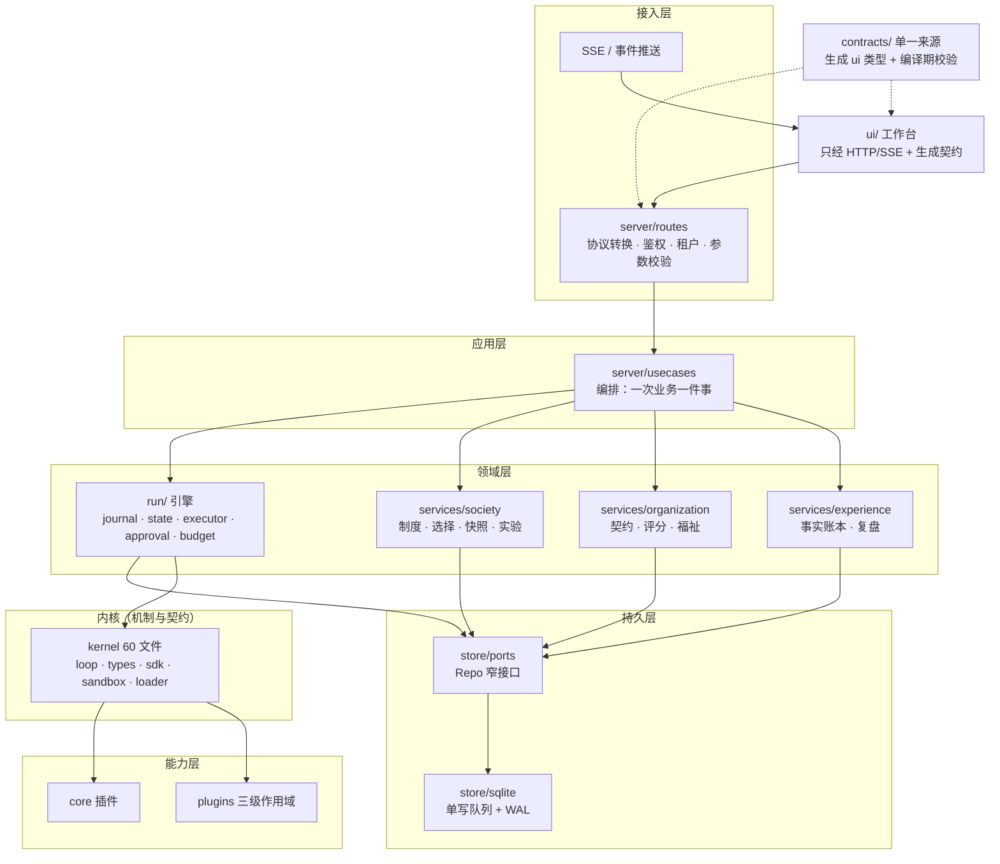

# maharness v4 架构设计提案

> 状态：提案（Proposed），未实施。基于 2026-11-21 质量审查与 2026-11-22 架构复核（`docs/ARCHITECTURE.md`、ADR 0001–0006、四层边界测试、实际代码规模）给出。
> 定位：**这不是重写方案**。现有架构约 70–80% 的部分（边界、事实源、插件模型、能力目录）应当保留，v4 只动"该重的那 20%"：中枢过厚、路由层越位、契约双写、存储无端口、热点度量失真。

---

## 一、需求与约束（先定边界，再谈设计）

### 功能需求（沿用现有产品语义，不改）
1. 单机网页版 Agent 工作台：会话、任务、文件、工作台、自动化、插件、AI 社会/组织。
2. Agent 可自扩展：模型可创建/验证/激活任务插件，但不可改授权、装依赖、接管运行服务。
3. 全程可观测：事件、工具账本、规则裁决、能力选择、插件源码哈希都能查到同一份事实。
4. 崩溃/断电可解释：断点可恢复，未知副作用不自动重放。

### 非功能需求（v4 明确写死，作为设计输入）

| 类别 | v4 目标 | 依据 |
| --- | --- | --- |
| 部署形态 | **单机单用户 / 小团队自托管**，零外部服务依赖 | 现状：Express + better-sqlite3 + 本地文件 |
| 并发 | 同时 8 个活动 Run、2 个社会调度 tick、单写者 | 本地硬件（R9000P）实测可承受 |
| 延迟 | HTTP p95 < 200ms（不含模型调用）、SSE 首帧 < 50ms | 本地交互体验 |
| 可靠性 | RPO ≈ 0（SQLite 事务 + WAL）、RTO < 1 分钟（重启即恢复） | 断点恢复已有 |
| 安全 | 插件默认不可信、授权交集、SSRF/路径/审批 402 条回归保持 | 已有基线 |
| 可维护性 | 单文件 ≤ 400 行、单函数 ≤ 60 行、圈复杂度 ≤ 15、模块 ≤ 3 个公开职责 | 替代"行数热点"口径 |
| 可测试性 | 关键文件逐文件覆盖 ≥ 70%、契约漂移 0 | 已有 `check:coverage` |

### 明确不做的（防止过度设计）
- 不拆微服务、不引入消息队列/Redis/K8s：单机场景下它们只增加运维成本。
- 不做完整事件溯源 replay（重放历史事件重建状态）：现有"事件日志 + 断点 + 账本"已够，完整 replay 会引入版本化难题。
- 不现在换 PostgreSQL：先做**端口化**，让换库变成一次适配器替换，而不是现在就换。
- 不改插件 SDK 契约（`apiVersion 3.0.0` 不动），插件方无感知。

---

## 二、目标架构



### 五层职责（一条铁律：只能向下依赖）

| 层 | 只做什么 | 绝不做 |
| --- | --- | --- |
| `routes/` | HTTP/SSE 协议、鉴权、租户作用域、参数形状校验、错误码映射 | 业务编排、状态机推进、跨服务事务 |
| `usecases/` | 一次用户意图的完整编排（含审批等待、预算、回滚点） | SQL、HTTP 细节、直接摸 core |
| `run/` 与 `services/` | 领域规则与状态机，纯函数优先，依赖注入时钟与端口 | 读 HTTP、拼 SQL 文本、import core |
| `store/` | 端口 + 适配器，单写队列，事务边界 | 业务判断 |
| `kernel/` | 机制与契约（判据见 ADR 0006） | 任何具体能力 |

**新增一条可执行边界**：`usecases → services` 允许，`routes → services` 不允许（必须经 usecase）；由 AST 测试强制，和现有两条边界同构。

---

## 三、五个关键变更

### C1：`RunService` 拆成 run 引擎（最优先）

现状 1,381 行承担 8 类职责。v4 拆为 5 个文件 + 1 个门面：

```text
server/run/
  journal.ts     // append(runId, event) / readAfter(seq) / subscribe(runId)
  state.ts       // 纯函数：reduce(state, event) → state；非法转移 throw
  executor.ts    // AgentLoop 调用、执行池、取消、超时、子任务
  approval.ts    // 审批等待/超时/恢复（不占执行槽）
  budget.ts      // 预留、用量、熔断（与 callModel 共享账本）
  service.ts     // 门面：对外仍叫 RunService，方法签名不变
```

```ts
// state.ts —— 纯函数状态机，可单测、可回放、无 IO
type RunEvent = { seq: number; type: string; data: unknown };
type RunState = 'queued' | 'running' | 'waiting_approval' | 'stopping' | 'interrupted' | 'completed' | 'failed' | 'cancelled';
export function transition(from: RunState, event: RunEvent): RunState { /* 唯一的转移表 */ }
```

- 收益：状态转移变成一张表 + 一批纯函数用例，替换掉"在 1,381 行里推演 8 状态"的成本；`executor` 与 `journal` 可分别替换（换进程内执行器 / 换事件存储）。
- 代价：`service.ts` 需要保持既有方法签名，迁移期用 facade 转发，测试无需改。

### C2：存储端口化 + 单写队列

```text
server/store/
  ports.ts        // SessionRepo / RunRepo / ItemRepo / PluginRepo / OrgRepo（窄接口，返回领域对象）
  sqlite/*.ts     // 现有 SQL 迁入（按聚合根分文件）
  write-queue.ts  // 进程内单写者：串行化写事务 + 背压 + 失败重试一次
```

- 好处：现在 `db.ts` 1,784 行 + 各服务直接摸 `Store`，换库要改几十处；端口化后换库只换适配器。
- 单写队列把"better-sqlite3 同步写 + 多调用点"的隐式串行，变成显式、可观测、可观测延迟的串行。不引入外部依赖。
- 分期：先包一层 `Store`→`Repo` 的转发（行为不变），再逐步把 SQL 搬家。

### C3：路由层瘦身，引入 usecases

现状 30 个 route 文件 + `shared.ts` 506 行，SSE、SSRF、密钥、git、文件管理、租户都在里面，且部分路由直接编排多个服务。

v4：
- `routes/*` 只做：解析 → 调 `usecases.<x>` → 映射响应/错误码；
- `server/usecases/` 按业务命名（`createRun`、`resumeRun`、`approveRun`、`openRunStream`、`saveWorkspacePlugin`、`tickSociety`…）；
- `shared.ts` 拆成 `sse.ts` / `security.ts`（SSRF/密钥擦除）/ `exec.ts`（git/文件）/ `scope.ts`（租户与工作区）。
- 强制：单 route 文件 ≤ 250 行；超过就说明编排没下沉。

### C4：契约单一来源（消灭双写）

现状 `ui/src/types.ts` 630 行 + `ui/src/api.ts` 628 行与后端类型并行维护。

```text
contracts/
  run.ts  plugin.ts  society.ts  organization.ts  api.ts   // 唯一类型定义（可复用 kernel/types 的纯类型）
ui/src/generated/contracts.ts                                // 自动生成，只读，不手改
scripts/check-contracts.mjs                                  // 生成物与源不一致 → 失败
```

- 生成方式不引重型工具：`tsc --declaration --emitDeclarationOnly` 产出 d.ts，再用 `tsc` 的 `.d.ts` 直接作为 UI 类型来源（零运行时依赖）。
- 收益：契约漂移从"人记得同步"变成"编译期红"；符合现有 `check-doc-facts` 的思路，但覆盖到全部字段而不是 6 个。

### C5：热点度量改用复杂度预算

行数已被 140 列格式化污染（同一文件 1,922 → 2,121）。v4 增加 `scripts/check-complexity.mjs`：
- 阈值：文件 ≤ 400 行（仅对新增/改动文件）、函数 ≤ 60 行、圈复杂度 ≤ 15、导出 ≤ 12；
- 白名单：历史大文件登记在 `plan/complexity-baseline.json`，**只许降不许升**（和覆盖率下限一个思路）；
- 输出可直接进 CI，替代"看行数猜哪里要拆"。

---

## 四、ADR 草案（Proposed）

### ADR-0007：部署定位与扩展路径

- **Context**：单进程 Express + 同步 SQLite + WAL，写入串行、CPU 单线程。当前文档未写清这是定位还是限制。
- **Decision**：明确 v4 的定位是"单机单用户 / 小团队自托管"，SQLite 是刻意选择；给出三条升级触发条件与对应路径：
  1. 活动 Run > 8 或写等待 p95 > 100ms → 进程内单写队列 + 批量提交（已有 C2）；
  2. 单库 > 5GB 或需要多机 → 端口化后换 PostgreSQL（C2 已铺路）；
  3. 需要多租户隔离 → 按租户分进程/分库，而不是改内核。
- **Alternatives**：直接上 Postgres（运维成本翻倍，当前无收益）；微服务化（本地部署场景无意义）。
- **Consequences**：正面是目标清晰、不误判成平台；负面是放弃"随时横向扩展"的幻想，需在 README/ARCHITECTURE 首页写明。

### ADR-0008：Run 引擎分层（journal / state / executor / approval / budget）

- **Decision**：`RunService` 保留为门面，内部拆五块；状态机是纯函数（唯一转移表），事件日志只追加不重放。
- **Alternatives**：完整事件溯源（重放重建）——版本化与迁移成本高，当前收益不足；继续单文件——修改成本已到临界。
- **Consequences**：可单测状态表、可换执行器；负面是短期存在 facade 转发层。

### ADR-0009：契约单一来源，前端类型生成

- **Decision**：类型只在 `contracts/` 定义，`ui/src/generated/` 为生成物，CI 校验一致。
- **Alternatives**：继续双写 + 文档校验（已证明会漂移，P2-4 就是同类问题）；引入 OpenAPI（当前是内部单机 API，收益低）。

### ADR-0010：路由只做协议，业务进 usecases

- **Decision**：新增 `usecases/` 层；AST 边界测试禁止 `routes → services` 直连；`shared.ts` 按关注点拆四块。
- **Consequences**：路由文件变小、可复用（CLI/测试可直接调 usecase）；负面是多一层跳转。

### ADR-0011：热点度量改用复杂度预算，行数只作参考

- **Decision**：CI 增加复杂度门禁 + 基线文件，行数不再作为拆分依据。
- **Consequences**：避免格式化造成的假热点；负面是要维护一份基线 JSON。

---

## 五、迁移路线（每期都可独立回退）

> **状态：0–4 期已于 2026-11-22 全部落地**，逐期实测见 [质量审查报告第八节](../QUALITY-REVIEW-2026-11-21.md)。

| 期 | 内容 | 改动面 | 验证 | 回退 | 状态 |
| --- | --- | --- | --- | --- | --- |
| 0（半天） | 加 `check:complexity` + `check:contracts` 骨架（只报告不失败）；写 ADR 0007–0011 | 脚本 + docs | 现有 1,560 单测不变 | 删脚本 | ✅ 完成（门禁已改为失败即阻断） |
| 1（1–2 天） | C1 拆 run 引擎：先搬 journal + state（纯函数），service 作 facade | `server/run/` 新增 4 文件 | `run-service.spec` 165 用例 + 全量 1,560 | 删新文件，恢复单文件 | ✅ 完成（5 文件，`run-service` 1381→**289**，另拆 `run/{create,society,delegate}`） |
| 2（1 天） | C3 路由瘦身：`shared.ts` 拆四块，抽 3–5 个 usecase 试点 | routes 局部 | E2E 133/133 + 契约测试 | 逐文件回退 | ✅ 完成（`server/http` 5 块 + Provider 编排下沉） |
| 3（2 天） | C4 契约生成：先只生成 `ui/src/generated/contracts.ts` 并与手写类型对齐 | ui 引用 | `ui:typecheck` + E2E | 切回手写类型 | ✅ 完成（`contracts/api.ts` 188 行，`types.ts` 630→518） |
| 4（2–3 天） | C2 存储端口化：`Store` → `Repo` 转发壳 + 单写队列；SQL 按聚合根搬家 | db 层 | db/崩溃/租户用例 | 保留转发壳，SQL 不动 | ✅ 完成（端口 + 单写者；SQL 已搬进 `store/sqlite/*`，`db.ts` 1784→1447；路由与 executor 一并收口，`run/recovery` 覆盖率 97.28%） |

原则：**每期结束都必须 `npm test` / `check:quality` / `e2e` 全绿才算完**；不允许"边拆边加功能"。

---

## 六、目标态验收指标

| 指标 | 基线（提案时） | v4 目标 | 实测（2026-11-22） |
| --- | --- | --- | --- |
| `server/run-service.ts` 行数 | 1,381 | ≤ 300（facade）+ 五个模块各 ≤ 250 | **289**（facade）+ `run/` 各模块 ≤250（`executor` 33 + `executor-start` 109 + `executor-flow` 158 + `executor-support` 243、`recovery` 147），另抽 `run/{create,society,delegate}` |
| 最大 route 文件 | `providers.ts` 658 行 | ≤ 250 行 / 单文件 | 全部 ≤250：`providers.ts` 86、`rules.ts` 190、`runs.ts` 210、`organization.ts` 202、`index.ts` 241（`health.ts` 142 承接健康/就绪/存储快照） |
| 关键文件覆盖率目标 | 无 | 逐文件 ≥70% | **21/21 达标**（含 `run/executor-start` 99.08%、`run/executor-flow` 100%）；`run/recovery` 34.69% → **97.28%**（`recovery.spec.ts` 16 条分支） |
| `server/db.ts` 行数 | 1,784 | 按聚合根拆仓储 | **1,447**（`store/sqlite/{providers,models,sessions,tenants}.ts` 承接 22 个方法，`db.ts` 只留一行委托 + 装配） |
| `routes/shared.ts` | 506 行 | 拆成 4 个 ≤ 150 行 | 18 行 barrel + `server/http/` 5 个文件（28–314 行） |
| 契约漂移 | 靠人/6 字段校验 | 生成 + 编译期报错 | `contracts/api.ts` 生成 UI 类型，`check:contracts` 字节比对，`contracts.spec.ts` 真实载荷断言 |
| 前端类型重复 | 630 + 628 行手写 | 0 手写（生成物） | `ui/src/types.ts` 518 行（9 个接口改 re-export，UI 专有类型保留）；`ui/src/api.ts` 重复 `SkillInfo` 已删 |
| 复杂度门禁 | 无 | 文件/函数/复杂度三项 + 只降不升基线 | `check:complexity` 三项 + 导出数，基线 **186** 个超标文件（5 处搬迁登记与 `executeRun` 已全部拆到达标，余额为迁移前遗留热点） |
| 边界测试 | 2 条（kernel、server→core） | 4 条（+ routes→services 禁止、usecases 不得摸 SQL） | 5 条（kernel 2 + `layering.spec.ts` 3） |

---

## 七、风险与对策

| 风险 | 影响 | 对策 |
| --- | --- | --- |
| 拆 RunService 时语义漂移（审批/预算/取消的时序） | 高（会改变行为） | 先补状态转移表用例，再拆；facade 保持签名；每步跑 165 条 run 用例 |
| 契约生成与现有手写类型不完全等价 | 中 | 先"生成 + diff 校验"，一致后再替换引用 |
| 存储端口化造成事务边界变化（一次业务多次写） | 高 | 端口方法显式接受事务句柄；单写队列内保证原子性 |
| 复杂度基线变成新的"免死金牌" | 中 | 基线只降不升 + 每期必须下降 10% |
| 过度拆分导致跳转层数增加 | 低 | 只在"一个文件超过 3 个职责"时拆，不按行数机械拆 |

---

## 八、和现状的关系（一句话）

v4 保留现有四条硬资产——**可执行的依赖边界、Run 作为唯一事实源、三级插件作用域、能力目录**；把五处结构性成本（中枢过厚、路由越位、契约双写、存储无端口、度量失真）改成结构上不可能再犯。**目标不是"更漂亮的架构"，而是"改动成本随文件数增长得更慢"。**
