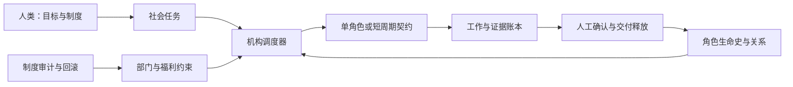

# AI 社会运行层

maharness 的产品本体由 AI 原生操作系统层和 AI 社会运行层共同组成。操作系统层提供 Run、工具、权限、审批、预算、缓存、取消、检查点、产物和插件契约；社会运行层提供持久角色、部门、制度、分工、履历、关系、福利约束和制度演化。主 Agent 是人类入口与协调器，不是社会运行的前提。

主 Agent 调用子代理只回答“这次由谁执行”。maharness 的社会层还回答组织在工作结束后是否继续存在、责任如何交接、角色如何积累履历、资源如何受制度约束，以及组织如何提出并审计制度变化。去掉主 Agent 后，已登记社会任务仍可由机构调度器推进：`queued → scheduled → awaiting_acceptance → completed`，执行失败可直接进入 `failed`。

## 人类、maharness 与 AI 角色

| 主体 | 职责 | 边界 |
| --- | --- | --- |
| 人类经营者 | 定义目标、业务价值、预算、授权和验收；批准高额任务；调整制度与最终采纳演化 | 不直接编辑调用链，也不替代运行事实 |
| maharness 社会层 | 按制度、部门配额、福利负载和净收益选择单角色或短团队；记录事实、审批、预算和审计 | 不替人类扩大目标、预算或权限 |
| AI 持久角色 | 在授权内执行契约、交接证据、报告异常、形成客观履历，并提出制度建议 | 不自批费用、不扩权、不自行持久化提案或修改评分规则 |

## 社会运行闭环



默认制度包含综合运营部、知识与研究部和质量与审校部。默认持久角色为调度协调员、研究执行员、交付执行员和质量审校员。角色由能力交集的主部门归属，同分时再按部门优先级裁决。

社会任务与 Run 是不同层级：任务先进入制度队列，调度后形成角色分工和契约，每个可执行契约再创建独立 Run。Run 使用独立执行会话、持久角色记忆、角色权限交集和契约硬预算；服务重启后由系统调度器恢复未完成契约，不依赖主 Agent 或聊天会话继续驱动。

## 单角色优先

团队只有在下列条件同时成立时启动：

- 至少两个独立分支，且每份产物和验收互不覆盖。
- 角色权限不超出人类授权，角色仍有福利容量。
- 部门配额、社会总预算和角色预算未被突破。
- 团队净收益超过入场门槛，并高于单角色基线。

净收益按以下决策估算计算。任务价值、质量权重和风险降低值来自人类或制度声明的输入；时延收益、预计成本与协调成本来自运行时估算。该结果用于调度比较，不是收益实测。

```text
net = value × quality + latencyBenefit + value × riskReduction
      - estimatedCost - coordinationCost
```

单角色可以完成、任务价值低、协调成本高或福利负载不足时保持单角色或排队。不存在“因为多 Agent 看起来更强所以扩团”的路径。

## 制度与审计

制度版本保存部门、部门能力、部门配额、并发容量、部门优先级、社会总预算、最低净收益、团队规模、福利并发上限、高额审批阈值和队列上限。人类在工作台调整制度时创建新的 active 版本；旧版本保留为 `superseded`。

每次初始化、变更和回滚写入不可覆盖的审计记录，包含操作者、前后版本、策略哈希和原因。回滚不修改历史，而是把目标版本的策略发布为新的 active 版本。浏览器 UI contract 在 mock API 下验证变更、审计、回滚和 `Esc` 只关闭当前组织弹窗。

角色与评价标准使用独立版本域。正式角色修改发布新的岗位版本并写入审计，运行时工作区与权限绑定不污染治理历史；评价标准保存履历置信门槛、排序权重、AI 复盘 Token 预算和判决门槛。两类对象均支持查询历史、审计和新版本回滚。创建 AI 复盘时冻结完整评价策略、版本和哈希。

## 福利与资源

`RoleWellbeingSnapshot` 记录并发负载、连续失败、审批等待、返工、上下文压力和状态。高负载时不再向同一角色分配新任务；审批等待保持休眠；上下文压力高时由现有运行时压缩、拆分或回退单角色。

福祉在 maharness 中是可观测的运行负担和协作条件，不映射为人类情感、意识、主观幸福或法律人格。

## Token 经济

预算分为三层：

| 层级 | 作用 |
| --- | --- |
| 社会总预算 | 当前租户所有社会调度的总上限 |
| 部门配额 | 部门可预留与已结算费用之和的上限 |
| 角色与任务账本 | 角色预算、任务最高预算、估算费用、价值、状态和 ROI |

相同 `EvidenceRef` 在多个角色和任务之间复用；共享材料引用会去重。Provider 未返回可验证缓存 usage 时，缓存节省保持 `null`，不把本地估算写成命中或节省。预算不足、福利满载、队列上限和低净收益均保留具体调度原因。

真实 Run 全部成功交付契约后，任务进入 `awaiting_acceptance`，只有人类确认才能进入 `completed`。失败、取消或缺少预期产物不会因总结文本变成成功。人工验收或终止后，短周期团队释放，角色回到可调度状态。角色生命史保留 appointment、schedule、delivery 或 failure 记忆；共同成功交付形成带证据的 `collaborated` 关系。履历来自实际交付，不来自角色自述。

## 人类经营界面

工作台内新增“maharness 社会运行”区域，不增加主导航一级入口：

- 展示社会健康、福利负载、三级预算、部门并发和瓶颈。
- 使用自然语言登记目标，同时设置业务价值、最高预算和承接部门。
- 展示排队原因、待人类审批、执行中短团队、最近释放与结果。
- 运行制度调度、批准或拒绝高额任务、确认并释放短周期角色。
- 调整社会总预算、福利并发和部门配额，发布新制度版本或回滚。
- 在项目组织视图中展开角色跨任务生命史、记忆、协作关系和福祉。

## 接口

| 接口 | 行为 |
| --- | --- |
| `GET /api/organization/society` | 社会健康、部门、网络、角色生命、预算、队列和调度事实 |
| `POST /api/organization/society/tasks` | 人类登记社会任务 |
| `POST /api/organization/society/tick` | 不调用主 Agent，按制度推进排队、契约 DAG 和未完成 Run |
| `POST /api/organization/society/tasks/:id/approve` | 人类批准或拒绝高额任务 |
| `POST /api/organization/society/tasks/:id/release` | 仅对 `awaiting_acceptance` 记录人工验收；或终止尚可干预的任务 |
| `GET /api/organization/society/experiments/:taskId` | 返回单角色与团队的声明输入、运行时估算和边际净收益估算 |
| `GET /api/organization/roles/:id/life` | 角色生命史、关系、履历和福祉 |
| `PATCH /api/organization/roles/:id` | 发布角色职责、能力、模型策略或预算的新版本 |
| `GET /api/organization/roles/:id/versions` | 查询角色岗位版本历史 |
| `GET /api/organization/roles/:id/audits` | 查询角色版本审计 |
| `POST /api/organization/roles/:id/rollback` | 从历史角色版本发布回滚版本 |
| `GET/POST /api/organization/evaluations` | 查询或发布评价标准版本 |
| `POST /api/organization/evaluations/rollback` | 从历史评价标准发布回滚版本 |
| `POST /api/organization/institution` | 发布制度新版本 |
| `POST /api/organization/institution/rollback` | 从历史版本发布回滚版本 |

`GET /api/workbench/summary` 聚合返回 `society`，工作台无需额外一级页面即可经营社会。

## 数据迁移

数据库 schema 14 保存制度、角色和评价标准版本及审计，并保存社会任务、社会调度、角色记忆、角色关系和可选根 Run 的工作单。系统调度创建的每份社会契约关联真实 Run；社会层只保存责任与治理摘要，不复制完整 Trace。

schema 13 到 14 回填现有角色 v1 与默认评价标准 v1，沿用现有数据库备份、事务和失败回滚机制。历史会话、Run、文件、事项、自动化、Experience、组织数据、v2 插件和 v3 插件保持兼容。

## 验收证据与当前状态

确定性脚本、mock API UI contract 与真实模型观测的当前状态见 [AI 社会 v1 验收证据与当前状态](AI-SOCIETY-ACCEPTANCE.md)。三者不能互相替代；真实模型原始执行为 1/9，修复后轨迹回放为 9/9，Overall live gate 未通过。
